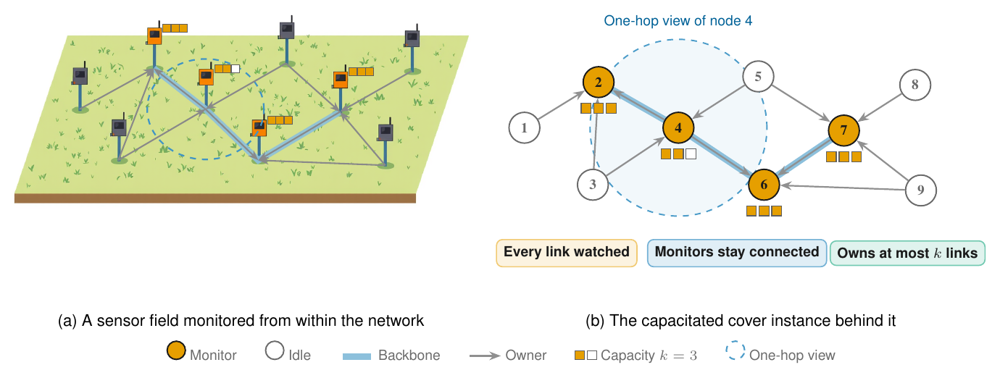
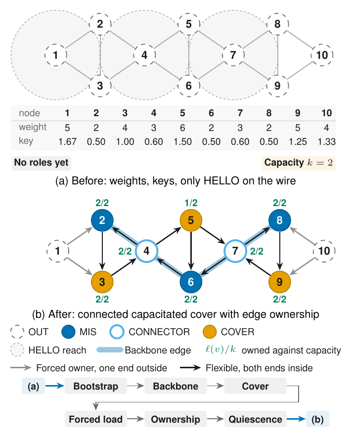
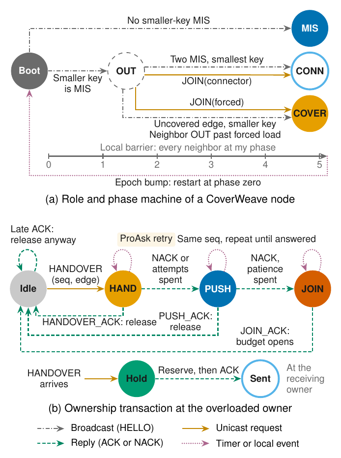
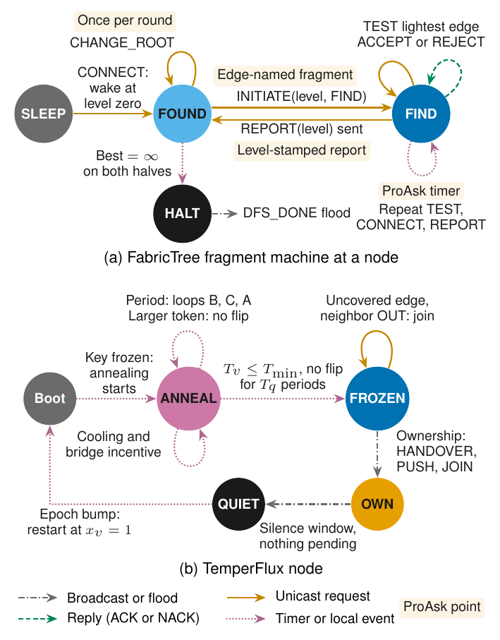

<div align="center">


# CoverWeave

**A distributed protocol that picks connected, capacity-bounded link monitors in a wireless sensor network and keeps working when radio messages are lost.**

*One-hop rules over a backbone, an ownership contract for every link, and an independent validator that checks every run.*


[Quick start](#quick-start) · [Reproducing the paper](#reproducing-the-paper) · [Results](#results) · [Algorithms and names](#algorithms-and-names) · [Step-by-step guide](docs/REPRODUCE.md) · [Pre-registration](contract/R1_PREREG.md) · [Cite](#how-to-cite)

</div>

A wireless sensor network is often spread over a field, a pipeline or a
building, and its radio links need watching for faults and attacks. A sensor can
watch the links that touch it, so the network chooses some sensors as monitors.
Three things are asked of that choice. Every link must have a monitor at one of
its ends, the monitors must be able to pass their reports to each other, and no
monitor may watch more than k links. Choosing such monitors at minimum total
weight is the minimum-weight connected capacitated vertex cover problem
(MWCCVC), and it is NP-hard.

Solving it inside the network is harder still. A sensor can check from its own
neighbourhood that its links are covered, but connectivity and capacity depend
on the whole network, and on a lossy radio channel a lost message leaves a
neighbour's view out of date. CoverWeave first elects a connected backbone and
lets only sensors next to that backbone become monitors, so the monitors stay
connected by construction. It then gives every link exactly one owner through a
handover contract that respects the capacity k. On a lossy channel it repeats a
request until it is answered and makes every reply safe to receive twice.

This repository holds the protocol, its backbone variants, the baselines, the
independent validator, three execution backends and the pre-registered
evaluation of the manuscript "A Loss-Tolerant Distributed Algorithm for
Minimum-Weight Connected Capacitated Vertex Cover in Wireless Sensor Networks",
which is under major revision at IEEE Access (manuscript ID Access-2026-53199).

## What it does

| | |
| --- | --- |
| **Three backbone arms** | The backbone phase is the one place where the arms differ. NexusWarp (code name `MIS-Connector-Backbone`) elects a maximal independent set and the connectors that join it from priority keys every node already hears. FabricTree (`GHS-MST-Backbone`) builds a distributed minimum spanning tree in the Gallager, Humblet and Spira line, hardened for loss. TemperFlux (`Anneal-Local`) elects no backbone and reaches connectivity through a simulated annealing energy term. Variants with tree aggregation and Trickle timing are included. The full map is in [docs/ALGORITHM_NAMES.md](docs/ALGORITHM_NAMES.md). |
| **Ownership contract** | Every link is written to exactly one owner, which must be a monitor at one of its ends. An overloaded owner hands a link over to the other end, pushes it further, or asks a neighbour to join the cover. The receiver reserves capacity before it acknowledges. |
| **Loss handling** | Every request carries a sequence number and is repeated with capped backoff until it is answered (the ProAsk rule). Replies are idempotent, so a duplicate request changes nothing. An epoch byte separates restarts, and a DONE barrier lets a finished network fall silent even when beacons are lost. |
| **Independent validator** | CoverAudit (`ccvc/bb/validate.py` and the validation path of `ccvc/bb/sweep.py`) recomputes the result from the raw cover and owner map and reads no counter a node kept. It checks that every link is covered, the cover is connected, every link has a valid owner, no owner exceeds k, the cover respects the counting lower bound, and no link is claimed by both ends. A run that reports success but fails the validator counts as a false success. |
| **Infeasibility certificates** | Some instances have no capacitated cover at all. A counting bound, a degree-gap witness and an exact maximum-flow check decide this, and every result row records which one applied. |
| **Baselines and references** | Wu and Li marking (Wu-Li CDS, three encodings), a token-based depth-first tree (TokenTrail), distributed greedy covers (D-GCCVC, D-GRCCVC, D-GWCCVC) and the centralized greedy references (C-GCCVC, C-GRCCVC, C-GWCCVC). Quality is measured against the proven optimum up to n = 50, the trivial cover of all nodes and a linear-programming lower bound. |
| **Three backends** | An event simulator (`ccvc/bb/simnet.py`, `ccvc/bb/sched.py`), real UDP sockets on one host with one process per node (exercised by `ccvc/bb/test_mnwifi.py`), and Mininet-WiFi emulation of IEEE 802.11 ad-hoc links with one process per station (`ccvc/bb/mnwifi/`). The node code is the same on all three. Every result names the backend it came from. |
| **Loss models** | Independent loss per frame, Gilbert-Elliott bursty loss with a given stationary rate and mean burst length, and per-link loss drawn from delivery ratios measured in Mininet-WiFi. |
| **Pre-registered evaluation** | Held-out topology families (G(n,m) graphs, unit disk graphs, Barabasi-Albert graphs) with seeds fixed in [contract/R1_PREREG.md](contract/R1_PREREG.md) before any instance was generated, a sealed reserve set, one frozen code version and blocks M2 to M9. |
| **Statistics** | `ccvc/bb/revision_stats.py` averages runs per instance, reports medians, spreads, bootstrap intervals and Clopper-Pearson bounds for validity, and runs paired one-sided Wilcoxon tests with Holm correction and rank-biserial effect sizes. |

## Figures

The figures come from the revised manuscript.

| | |
| --- | --- |
| **Link monitoring as a capacitated cover.** Monitors cover every link, stay connected through the backbone and own at most k links each<br> | **The worked example of the paper before and after CoverWeave.** Ten nodes with capacity k = 2, from weights and keys to a connected cover with an owner for every link<br> |
| **The node program.** Role and phase machine, and the ownership transaction of an overloaded owner with its repeated requests<br> | **Two backbone arms as state machines.** The FabricTree fragment machine and the TemperFlux node from annealing to ownership<br> |

## Quick start

### Requirements

The code was tested with Python 3.12.4 on Linux. The protocol, the simulator,
the validator, the held-out generator and the run scripts use the standard
library only. Other packages are needed for single tasks.

| Package | Needed for | Tested version |
| --- | --- | --- |
| `numpy`, `scipy` | the statistics script `ccvc/bb/revision_stats.py` | 1.26.4, 1.11.4 |
| `matplotlib` | the figure and table scripts | 3.11.1 |
| `networkx` | one figure script, `ccvc/bb/wifi_graph_figure.py` | 3.2.1 |
| `pytest` | the test suite | 9.0.2 |
| Mininet-WiFi with wmediumd | the wireless emulation, run as root | |

```bash
git clone https://github.com/egerberkuslu/coverweave-distributed-mwccvc.git
cd coverweave-distributed-mwccvc
python3 -m pip install numpy scipy matplotlib networkx pytest
```

Run every command from the repository root. The modules compute the root from
their own location, so keep the directory layout as it is.

### Benchmark dataset

The development set is the published 360-file benchmark. It is not stored here.
The fetcher downloads it at a pinned revision and checks the bytes of every
file.

```bash
python3 tools/fetch_dagdeviren.py
```

The files land in `data/DagdevirenDataset/` and the source checkout in
`external_sources/MWCCVC/`. Both paths are ignored by git.

### Tests

```bash
PYTEST_DISABLE_PLUGIN_AUTOLOAD=1 python3 -m pytest ccvc -q
```

The full suite takes about six minutes on one workstation. Some tests of the
older layer under `ccvc/` read the benchmark dataset. The variable
`PYTEST_DISABLE_PLUGIN_AUTOLOAD=1` keeps unrelated pytest plugins installed on
the machine out of the run.

### The worked example of the paper

```bash
python3 -c "
from ccvc.bb import bbcvc, validate
from ccvc.bb.figures import WORKED_EDGES as E, WORKED_WEIGHTS as W, WORKED_K as K
r = bbcvc.run_bbcvc(E, W, K, scheduler='sync', max_ms=600_000)
rep = validate.validate(validate.make_graph(E, K, W), r.cover, r.owner)
print(r.verdict, sorted(r.cover), r.total_weight, r.slots, r.tx, r.rx, r.bytes_tx, rep.valid)
"
```

This runs CoverWeave with the NexusWarp backbone in the event simulator on the
ten-node example with k = 2 and checks the result with the validator. It prints
the verdict, the cover, its weight, the slot count, the transmissions, the
deliveries, the transmitted bytes and the validator verdict. The cover is
{2, 3, 4, 5, 6, 7, 8, 9} with weight 27, as in the worked example figure above.

### A small held-out set

```bash
python3 -m ccvc.bb.heldout --set H1 --out heldout-smoke --seeds 1-3
```

This writes 48 instances of the H1 family and a `manifest.json` with the
sha256 of every file. Seeds 1 to 3 are for trying the generator. The
pre-registered seeds are drawn only by the default path without `--seeds`, and
`--seeds` refuses them. `python3 -m ccvc.bb.heldout --validate` compares the H1
generator with the published files.

### One run of the revision runner

`ccvc/bb/r1_run.py` runs one job, that is one instance under one capacity, one
channel condition and one channel seed, with a list of arm and scheduler
configurations. Write the job as one JSON line.

```bash
mkdir -p runs
cat > runs/jobs.jsonl <<'EOF'
{"id": "demo", "dataset": "heldout-smoke/H1/ratio2", "instance": "n10_m20_s1.txt", "group": "small", "n": 10, "m": 20, "ratio": 2, "seed": 1, "k": 6, "loss": 0.05, "rng_seed": 1, "configs": [["MIS-Connector-Backbone", "sync"], ["Anneal-Local", "async"]], "max_ms": 600000, "mis_nbrs_max": 64, "out": "runs/demo.csv"}
EOF
BB_SNAPSHOT=$PWD PYTHONPATH=$PWD python3 -m ccvc.bb.r1_run --jobs runs/jobs.jsonl --id demo
```

The runner appends one row per configuration to `runs/demo.csv` as soon as it
is measured and writes `runs/demo.csv.done` when the job is finished. Running
the same job again skips rows that already exist. Each row carries the
`code_fingerprint` of the code it ran and the validator columns. The `loss`
field takes a probability for independent loss, `"ge:<rate>:<burst>"` for
Gilbert-Elliott loss, or `"emp"` for per-link loss from the measured delivery
ratios. `BB_SNAPSHOT` must name the directory the code is imported from, so a
run can never measure a different tree than the one it names.

### Statistics

```bash
python3 -m ccvc.bb.revision_stats --rows runs/demo.csv \
    --instance-dir heldout-smoke/H1/ratio2 --out runs/stats
```

This writes `summary.md` and CSV files with validity, quality, paired tests and
LP bounds to `runs/stats/`. Proven optima and centralized results are joined
only to instances read from the published benchmark directory, so held-out rows
are compared with the LP bound and the trivial cover. Without any argument the script reads the development sweep
and writes to `results/bb/r1_stats/`.

### Mininet-WiFi emulation

The emulation needs root and a working Mininet-WiFi installation. It is split
into three modes, and only `run` needs privilege.

```bash
python3 -m ccvc.bb.mnwifi.run plan --graph <graph.json> --k 6 --mode sync \
    --node bbcvc --run-id <name> --run-root <directory>
sudo -E env PYTHONPATH=$PWD python3 ccvc/bb/mnwifi/run.py run --resume <directory>/<name>
python3 -m ccvc.bb.mnwifi.run collect <directory>/<name>
```

`plan` places the stations, assigns addresses and timing, writes the run
directory and prints the exact privileged command. `run` builds the ad-hoc
network under wmediumd, starts one process per station, stops them once every
station is quiet and collects the logs. `collect` evaluates a finished run
directory without privilege. Graphs of the W family come from
`python3 -m ccvc.bb.heldout --set W`, which also writes a `.json` graph for
`--graph`. `run` refuses to start while another wmediumd network is running,
because the Mininet cleanup stops every wmediumd process on the machine.

## Reproducing the paper

Every number in the revised manuscript comes from one code version.

1. **Frozen tag.** The annotated tag `coverweave-r1-frozen` marks that version.
   Check it out before running anything.
2. **Fingerprint.** `python3 -c 'from ccvc.bb import sweep; print(sweep.code_fingerprint())'`
   prints a 12-digit sha256 over the bytes of the modules on the measurement
   path. Every result row stores this value in its `code_fingerprint` column,
   and the runner refuses to start if `R1_FROZEN_FINGERPRINT` is set to a
   different value.
3. **Pre-registration.** [contract/R1_PREREG.md](contract/R1_PREREG.md) fixes,
   before any held-out instance existed, the held-out families and their seeds,
   the sealed reserve, the arms and references, the endpoints, the hypotheses and
   tests, and three dated amendments, including the protocol repairs F1 to F6
   found by a proof audit.
4. **Blocks.** M2 re-runs the development set at the tag. M3 and M4 run the
   held-out families H1, H2a and H2b. M5 varies capacity tightness, M6 the loss
   model, M7 the Mininet-WiFi runs, M8 the protocol parameters and M9 instances
   that only the flow check proves infeasible.
5. **Outputs.** Each job writes its own CSV, and the statistics script turns
   the rows into the tables of the paper.

The exact step list is in [docs/REPRODUCE.md](docs/REPRODUCE.md).

## Results

> Results of the frozen version are added here when the pre-registered runs finish.

This section will point to the result directory of the frozen tag and to the
tables it produces, one per block. It holds no numbers yet on purpose. The
files under `results/bb/` come from the submitted version, which mixed several
code versions, and are described in [results/README.md](results/README.md).
Energy values in any table are model estimates for an ESP32 radio and never
measured Mininet-WiFi energy.

## Repository layout

```
.
├── README.md, CITATION.cff, .gitignore
├── ccvc/
│   ├── bb/                CoverWeave: node program, arms, wire format, simulator,
│   │                      scheduler, validator, sweep and revision runners,
│   │                      held-out generator, statistics, tables, figures, tests
│   ├── bb/mnwifi/         Mininet-WiFi orchestrator, station process, UDP port, collector
│   ├── greedy/            distributed and centralized greedy baselines
│   ├── live/              earlier host-level ad-hoc measurement scripts
│   └── *.py               earlier CCVC layer, including the exact solver
├── contract/R1_PREREG.md  pre-registration of the revision with its amendments
├── docs/
│   ├── ALGORITHM_NAMES.md code names, paper names and what each arm does
│   ├── REPRODUCE.md       step list for the paper
│   ├── figures/           figures of this page
│   └── brand/             logo
├── results/               measurements of the submitted version, see results/README.md
└── tools/fetch_dagdeviren.py   dataset fetcher
```

The manuscript source is added to this repository at resubmission.

## Algorithms and names

The code names an arm after its mechanism and the paper prints a shorter name.
Nothing in the code is renamed. The translation happens when a name is printed,
through `DISPLAY_NAMES` in `ccvc/bb/armnames.py`.

| Code name | Paper name | Role |
| --- | --- | --- |
| `BB-CVC` | CoverWeave | the protocol |
| `MIS-Connector-Backbone`, `MIS-Connector-TreeAgg` | NexusWarp, NexusWarp-T | independent set and connector backbone |
| `GHS-MST-Backbone` | FabricTree | spanning tree backbone |
| `Anneal-Local`, `Anneal-TreeAgg`, `Anneal-Trickle` | TemperFlux, TemperFlux-T, TemperFlux-Tk | simulated annealing without a backbone |
| `DFS-Spanning-Backbone` | TokenTrail | depth-first token tree |
| `WuLi-Dominating-Exact`, `-Bloom`, `-Chunked` | Wu-Li CDS, Wu-Li CDS/B, Wu-Li CDS/C | baseline, Wu and Li marking |
| `Greedy-Degree-Backbone`, `Greedy-Ratio-Backbone`, `Greedy-Weight-Backbone` | D-GCCVC, D-GRCCVC, D-GWCCVC | baseline, distributed greedy |
| `Greedy-Degree-Upstream`, `Greedy-Ratio-Upstream`, `Greedy-Weight-Upstream` | C-GCCVC, C-GRCCVC, C-GWCCVC | reference, centralized greedy |

The paper also names the independent validator CoverAudit and the rule that
every request is repeated until answered ProAsk. Both are explained in
[docs/ALGORITHM_NAMES.md](docs/ALGORITHM_NAMES.md).

## Dataset attribution

The development instances come from the Dağdeviren benchmark, introduced with
the weighted connected vertex cover study for energy-efficient link monitoring
and fetched by `tools/fetch_dagdeviren.py` at a pinned revision. Please cite it
as

> Z. Akusta Dağdeviren, "Weighted connected vertex cover based energy-efficient
> link monitoring for wireless sensor networks towards secure Internet of
> Things," *IEEE Access*, vol. 9, pp. 10107-10119, 2021.
> doi: 10.1109/ACCESS.2021.3050930

The MWCCVC problem definition and the centralized greedy algorithms come from
Kol et al., *Sensors* 26(9):2752, 2026, doi: 10.3390/s26092752. The held-out
families are generated by `ccvc/bb/heldout.py` and are new.

## How to cite

The manuscript is under review, so please cite it as unpublished work and
replace the entry once it appears.

```bibtex
@unpublished{uslu2026coverweave,
  author = {Uslu, Ege Erberk and Kol, Miray and \c{C}abuk, Umut Can and Da\u{g}deviren, Z\"{u}leyha Akusta and Da\u{g}deviren, Orhan},
  title  = {A Loss-Tolerant Distributed Algorithm for Minimum-Weight Connected Capacitated Vertex Cover in Wireless Sensor Networks},
  note   = {Manuscript under review at IEEE Access, manuscript ID Access-2026-53199},
  year   = {2026},
  url    = {https://github.com/egerberkuslu/coverweave-distributed-mwccvc}
}

@article{kol2026,
  author  = {Kol, Miray and Uslu, Ege Erberk and Da\u{g}deviren, Z\"{u}leyha Akusta and Da\u{g}deviren, Orhan},
  title   = {Design and analysis of minimum-weighted connected capacitated vertex cover algorithms for link monitoring in {IoT}-enabled {WSNs}},
  journal = {Sensors},
  year    = {2026},
  volume  = {26},
  number  = {9},
  pages   = {2752},
  doi     = {10.3390/s26092752}
}

@article{dagdeviren2021,
  author  = {Da\u{g}deviren, Z\"{u}leyha Akusta},
  title   = {Weighted connected vertex cover based energy-efficient link monitoring for wireless sensor networks towards secure {Internet of Things}},
  journal = {IEEE Access},
  year    = {2021},
  volume  = {9},
  pages   = {10107--10119},
  doi     = {10.1109/ACCESS.2021.3050930}
}
```

`CITATION.cff` carries the same data in machine-readable form, and GitHub shows
it as the "Cite this repository" button.

## Authors

| Author | Affiliation | ORCID |
| --- | --- | --- |
| Ege Erberk Uslu | Graduate School of Natural and Applied Sciences and Department of Computer Engineering, Ege University, Izmir, Türkiye | [0000-0001-9119-8574](https://orcid.org/0000-0001-9119-8574) |
| Miray Kol | Graduate School of Natural and Applied Sciences and Department of Computer Engineering, Ege University, Izmir, Türkiye | [0009-0007-6588-5590](https://orcid.org/0009-0007-6588-5590) |
| Umut Can Çabuk | Department of Electrical and Computer Engineering, California State University San Marcos, San Marcos, CA, USA | [0000-0002-5166-4670](https://orcid.org/0000-0002-5166-4670) |
| Züleyha Akusta Dağdeviren | Department of Computer Engineering, Ege University, Izmir, Türkiye | [0000-0001-9365-326X](https://orcid.org/0000-0001-9365-326X) |
| Orhan Dağdeviren | Department of Computer Engineering and Department of Artificial Intelligence and Data Engineering, Ege University, Izmir, Türkiye | [0000-0001-8789-5086](https://orcid.org/0000-0001-8789-5086) |

## Acknowledgement

This work was supported by Amateur Radio Digital Communications (ARDC) under
grant no. 1821.

## Licence and contact

This repository has no licence file at present, so no licence is granted beyond
viewing the code. Please ask the corresponding author before reuse.

Corresponding author: Umut Can Çabuk, ucabuk@csusm.edu.
